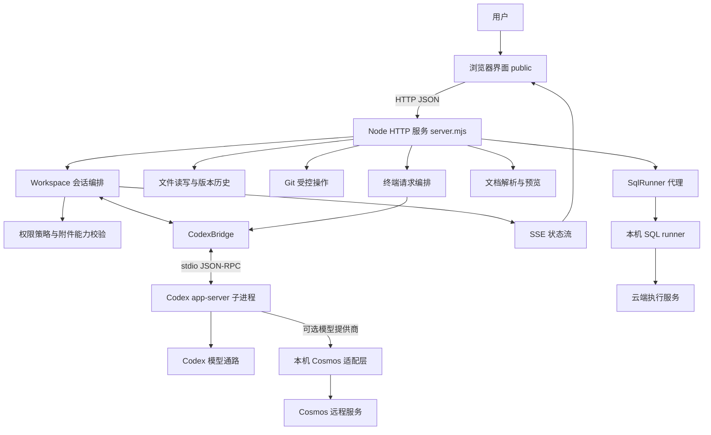
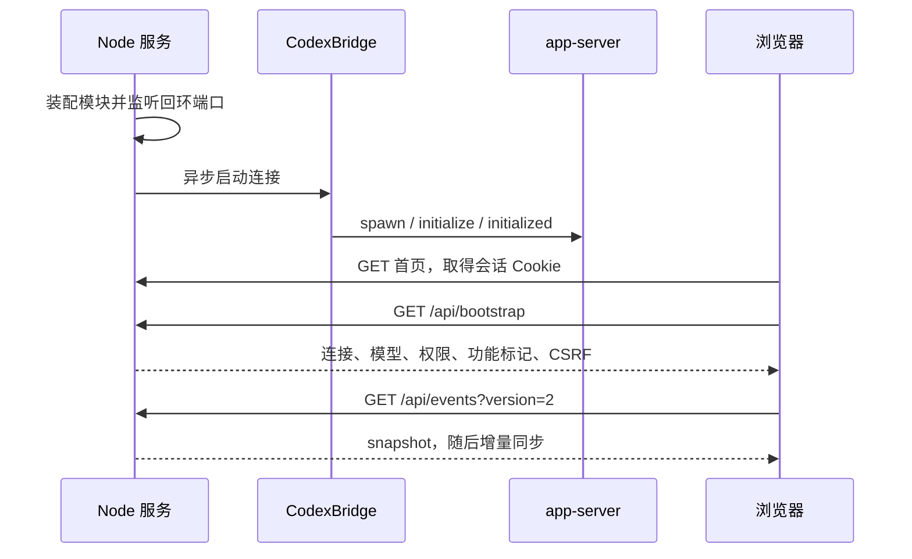
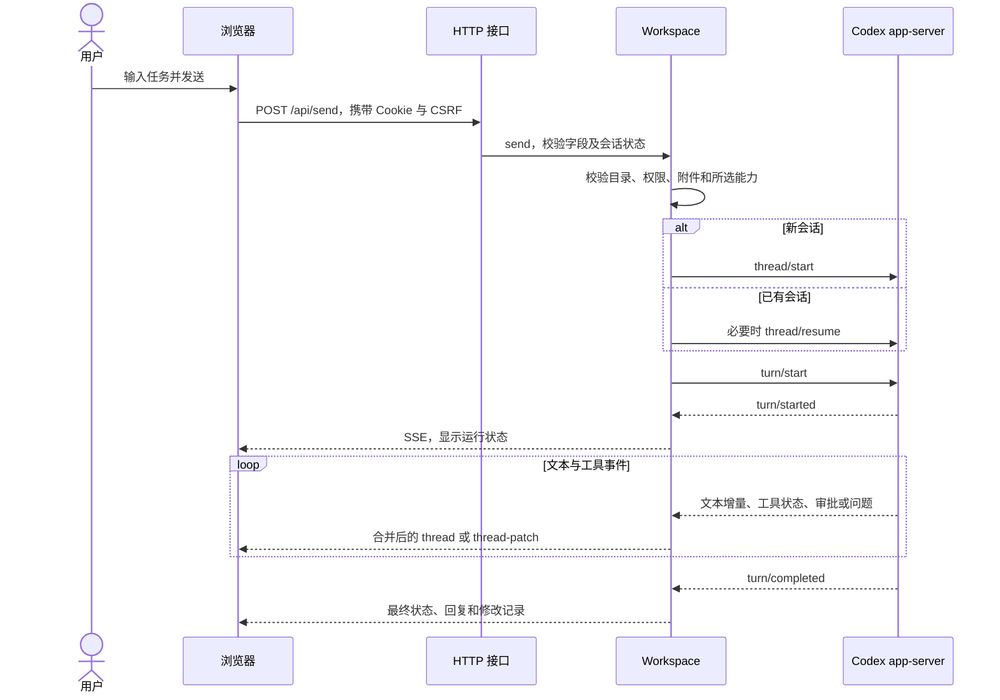
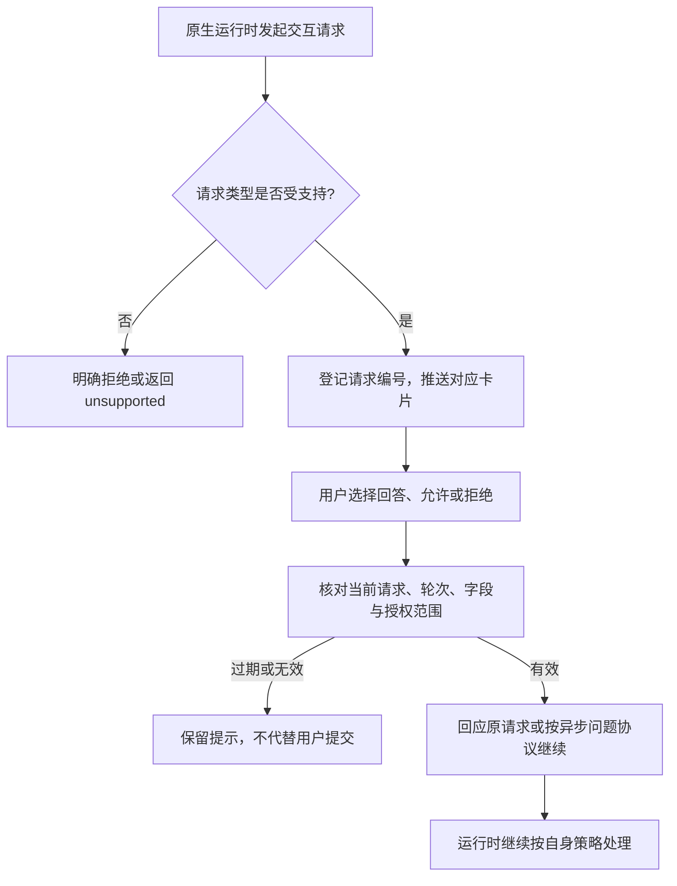
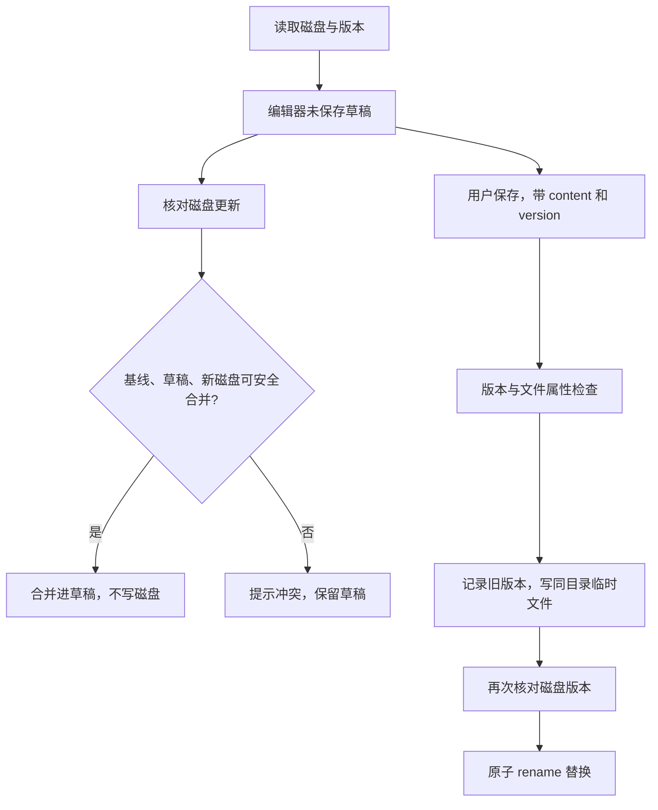
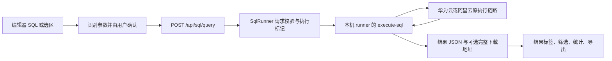
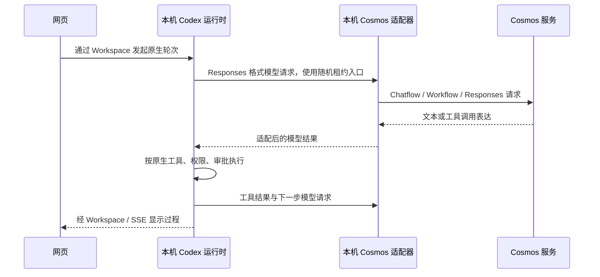

# 柠檬工作台：项目说明、运行原理与维护指南

> 核对日期：2026-10-16。依据为当前本地工作树的代码，包括尚未提交的功能；不代表远程仓库、已运行进程或其他机器已更新到相同版本。
>
> 本文面向首次了解项目的读者和接手维护的开发者。功能描述以本地实现为准；部署路径标注为“当前 Mac”的，仅适用于这台机器。本文整理不涉及服务重启、真实模型调用或 SQL 执行。

## 阅读导航

| 想了解什么 | 建议章节 |
| --- | --- |
| 项目做什么、主要功能有哪些 | [1–2](#1-项目定位与适用范围) |
| 网页怎样调用 AI、怎样显示进度 | [3–5](#3-总体架构) |
| 追加消息、提问、审批、子任务怎样工作 | [6–7](#6-会话追加计划和持续目标) |
| 项目、聊天、文件、草稿为什么有时恢复不了 | [8](#8-数据保存在哪里以及怎样恢复) |
| 权限控制到了哪里、是否具备用户隔离 | [9](#9-安全权限与隔离边界) |
| 文件、SQL、终端、Git、附件等具体能力 | [10–15](#10-文件浏览搜索编辑与恢复) |
| Codex / Cosmos、插件、记忆与应用授权 | [16–18](#16-codex-与-cosmos-模型通路) |
| 代码入口、HTTP 接口与配置 | [19–21](#19-代码目录与修改入口) |
| 如何部署、测试和排查故障 | [22–24](#22-部署常驻服务与维护) |

相关文档：[README](README.md) 提供使用入口；[AGENTS.md](AGENTS.md) 规定维护约束；[桌面体验记录](PRODUCT-UX-REVIEW.md)、[升级记录](WORKBENCH-UPGRADE.md)、[补全调研](AUTOCOMPLETE-RESEARCH.md) 保留专项背景和历史验收。历史测试数量与版本号不是当前运行状态的证明。

## 1. 项目定位与适用范围

柠檬是一个在本机运行的中文 AI 工作台。用户通过浏览器聊天、编辑文件、查看结果，由 Node.js 服务连接本机 Codex 运行时以及 SQL runner 等服务。

它把“找文件 → 编辑 → 查询 → 分析 → 核对修改”放在同一个桌面工作区中。核心分工是：

- **浏览器**负责界面、输入、草稿和展示。
- **Node 服务**负责 HTTP 接口、会话编排、文件访问、版本检查和实时同步。
- **Codex app-server**负责原生会话、模型推理及模型发起的工具调用。
- **SQL runner**负责把已确认的 SQL 交给原来的执行服务，保留原接口的操作限制。
- **Cosmos 适配层**可替换模型请求通路，工具仍交回本机运行时执行。

本项目适合本人在可信本机使用。它没有独立的网页账号体系、租户管理或按网页用户划分的操作系统环境。项目目录、会话、浏览器入口的区分，不等于账号、费用或文件系统完全隔离。

“本机运行”指界面和工具宿主在本机，不表示模型离线运行。聊天、AI 续写或工具按需要向所选模型服务及获准的外部服务发送请求。

源码入口：[server.mjs](server.mjs)、[Workspace](lib/workspace.mjs)、[CodexBridge](lib/bridge.mjs)。

## 2. 功能全景与界面组织

| 区域 | 主要能力 | 使用时需要知道的边界 |
| --- | --- | --- |
| 项目与文件 | 多项目、目录、隐藏项开关、文件名搜索、路径复制 | 列表记录目录路径；添加项目不复制目录、不自动扩大运行时权限 |
| 编辑器 | 多标签、高亮、查找替换、格式化、磁盘同步、三方合并、保存历史 | 未保存内容先留在草稿；打开标签与保存正文是两件事 |
| 对话 | 流式回复、历史、搜索、改名、归档、分叉、上下文整理、计划与持续目标 | 历史以原生运行时为来源；目标、排队、计划模式有不同用途 |
| 任务交互 | 工具过程、审批、补充问题、立即追加、队列、子任务 | 选中选项不等于已提交；界面重连不自动重发操作 |
| 查询结果 | 华为云/阿里云入口、参数、结果标签、筛选、排序、复制、导出、统计 | 查询经本机 runner；页面关闭不表示云端已取消 |
| 终端 | 行式命令、标准输入、输出、中断、历史 | 受限执行器，不是完整 PTY/TUI；默认只读、无网络 |
| 变更与 Git | AI 修改记录、保存历史、代码审查、提交、推送、快进拉取、Worktree | 每种恢复/提交来源不同；不自动合并分叉或覆盖脏工作区 |
| 文档与成果 | Markdown、图片、PDF、Excel、静态 HTML | 本机有界预览；Excel 不运行宏或重算公式 |
| 设置 | 模型服务、插件连接、草稿缓存、跨会话记忆、应用授权、定时任务 | 部分设置影响同一原生配置环境下的其他客户端 |

桌面主区支持“对话 / 并排 / 文件”。工具面板覆盖显示；终端和查询结果共用底部面板。切换面板保留其已有内容，不自动停止任务。Markdown、代码、PDF、Excel 共用文件标签。

外观有辉光、经典、极光、深空、绯霞、曜石，支持深浅色；编辑器、对话、终端、结果和工具面板可单独选择深浅色。当前维护只验收桌面端。

## 3. 总体架构



### 3.1 浏览器层

前端主要采用原生 ES Module、DOM、`fetch` 和 `EventSource`，没有使用 React/Vue。常规界面脚本由 Node 直接返回，职责拆在 `public/` 中。

Markdown 文档预览是单独的构建链路：`browser/` 中的源码经 esbuild 生成 `public/vendor/markdown/`。因此“普通前端无需整体打包”不代表所有浏览器资源都没有构建步骤。

### 3.2 Node 服务层

`createApplication()` 装配会话、文件、Git、SQL、预览、记忆等模块。HTTP 路由完成认证和参数接收，再调用对应业务方法；服务始终绑定回环地址 `127.0.0.1`。

磁盘文件读写、Git 和 SQL 代理有各自接口。它们不是先让模型解释指令再执行，也不统一套用聊天会话的 sandbox 设置；见第 9 章的权限分层。

### 3.3 原生运行时层

`CodexBridge` 启动独立的 app-server 子进程，通过标准输入/输出逐行交换 JSON-RPC 消息。当前启动参数还启用了普通模式补充提问：

```text
codex -c features.default_mode_request_user_input=true app-server --stdio
```

请求包括 `thread/start`、`thread/resume`、`turn/start`、`turn/steer`；通知包括文本增量、工具状态和轮次完成；反向请求包括审批与用户提问。

Bridge 使用请求 ID 匹配响应，设置请求等待超时，掉线时拒绝未完成的本地等待。超时只说明没有取得确定响应，不能据此推断操作从未执行。子进程 stderr 被主动消费而不写入工作台日志，避免插件或提供商输出敏感信息。

## 4. 启动与模型发现

### 4.1 可执行文件查找顺序

当前 [bridge.mjs](lib/bridge.mjs) 的顺序是：

1. 显式 `CODEX_BIN`。
2. macOS 官方桌面应用随附的运行时：依次检查 `/Applications`、`~/Applications` 中 `ChatGPT.app/Contents/Resources/codex-cli/bin/codex`。
3. 当前用户已安装的 Cursor 官方 `openai.chatgpt` 扩展内，匹配平台与架构的可执行文件。
4. PATH 中的 `codex`。

以上是代码中的查找策略，不表示每台机器都安装了这些来源。其他平台不会检查 macOS 应用路径；本项目部分能力仍依赖 macOS 和 `/bin/zsh`，不能仅凭 Node 可启动就宣称跨平台完整可用。

### 4.2 服务与页面的初始化



HTTP 端口监听成功与 Codex 已连接是两个状态。运行时暂时离线时，服务仍能返回页面；项目文件浏览和手工编辑等接口也可独立工作。

### 4.3 模型列表与账户额度

模型目录通过原生 `model/list` 分页读取，不把固定型号写死在页面里。界面打开选择器、恢复焦点或重新可见时节流刷新，失败保留既有选择，不自动换模型。

账户额度来自 `account/rateLimits/read`。页面区分真实周期、token/上下文用量和额度；它不是费用账单。缺字段、连接失败或登录方式不支持时显示未知。Cosmos 通路不以 Codex 额度代表其自身用量。

## 5. 聊天请求与实时更新

### 5.1 一条消息如何完成



`/api/send` 的主要字段为 `text`、`cwd`、`threadId`、`model`、`modelService`、`effort`、`mode`、`plan`、`attachments`、`capabilities`，以及可选 `goal`。不是每个字段都必填，具体校验见 `Workspace.send()`。

服务端对当前会话加提交锁，核对已有会话是否在其他客户端运行、所选模型服务是否匹配、权限能否使用。它把附件编号解析成已登记记录，把 Skill/插件选择解析成运行时定义，再开始轮次。界面先出现 pending 消息用于即时反馈，最终仍以运行时结果为准。

### 5.2 流式显示与 SSE

`Workspace.notification()` 合并 `item/agentMessage/delta`，通过约 45 毫秒的合并窗口减少重复广播。[event-stream.mjs](lib/event-stream.mjs) 提供：

- 初次完整 `snapshot`。
- 旧页面可用完整 `thread`；声明 `version=2` 的页面接收后续 `thread-patch`。
- 补丁带消息 ID、顺序和会话版本，避免把旧更新套到新状态。
- 每 15 秒心跳；心跳仅证明连接活动，不证明模型正在推进任务。
- 写入背压时等待 `drain`，每个会话只保留最新待发送状态；无进展超时再释放慢连接。

消息由普通 HTTP 发出，进度由 SSE 接收，因此无需用 WebSocket 承担全部通信。

### 5.3 断线、重试与错误

页面会退避重连。服务重启造成 Cookie 失效时，通过同源首页续会话并重新取 CSRF，再只读同步状态。这个过程不自动重发聊天、审批、SQL 或终端命令。

运行时通知 `error.willRetry=true` 时，页面显示本轮“模型请求重试”；这是运行时自己的重试状态，与网页 SSE 重连不同。最终失败继续显示原任务错误。上游 HTML 错误页只显示状态和简短排查说明；403 不能直接解释成额度不足或登录失效。

## 6. 会话、追加、计划和持续目标

| 操作 | 实际行为 | 限制 |
| --- | --- | --- |
| 历史列表 | `thread/list`，按项目读取；标题搜索或分页正文搜索 | 正文搜索只读用户/助手消息，不搜索全部工具输出；每页 40 个会话 |
| 打开历史 | `thread/read` 恢复已保存记录 | 不凭缺失历史补造进度、图片或成功结论 |
| 改名、归档、分叉 | 使用原生会话接口 | 由原生会话保存，独立于浏览器项目列表 |
| 上下文整理、审查 | 原生 compact/review 操作 | 需核对任务、队列与持续目标状态；安全恢复使用只读模式 |
| 立即追加 | `turn/steer`，绑定预期轮次 | 追加到当前任务；不另开竞争轮次 |
| 排队下一轮 | Node 内存队列，保留消息原权限、模型和附件 | 最多 20 条；错误/停止后暂停；完全访问和活动持续目标不支持自动排队 |
| 计划模式 | 原生计划协作模式，强制只读且禁止提权 | 不等同于已经批准执行计划 |
| 持续目标 | 原生 `thread/goal/set` / `clear` | 可设置目标与正整数 token 预算，支持暂停/继续/完成；不是定时任务 |

目标正文最多 4,000 字符。对于尚未恢复的历史会话，单独编辑目标先以只读恢复，避免把历史完全访问权限隐式带回来。

已有名称以原生名称为准。未命名的 Codex 会话可使用独立、临时、禁用工具的标题辅助请求；Cosmos 标题在本机取首条消息的干净短预览，不额外调用模型。手工名称和较新的名称不会被迟到结果覆盖。

对应代码：[Workspace](lib/workspace.mjs)、[标题生成](lib/thread-titles.mjs)、[前端控制器](public/app.js)。

## 7. 审批、补充问题与 AI 子任务

### 7.1 审批不是一种统一的“确定”按钮

命令、文件修改、权限扩展、插件表单和应用授权分别解析、分别校验。不支持的请求返回明确错误或拒绝，不用空答案假装已经完成。

“全部允许一次”只处理点击时当前会话已列出的命令/文件修改请求，逐条发送一次允许。新增请求、补充问题、插件交互和权限扩展不会自动加入；切换会话或断线会停止余下提交。

权限扩展明确区分本轮授权与永久设置。网页没有“看到请求就默认允许”的逻辑；选择“帮我批准”时，由运行时的自动审查机制决定。



### 7.2 同步与异步提问

支持两条协议：

- `item/tool/requestUserInput`：通过原 JSON-RPC 请求回答。
- `agentMessage.questions`：生成异步问题卡片，回答按问题编号回到原会话。

用户可选择选项、输入自由回答、跳过单题或整组。默认选中不算作答。异步回答遇到运行中的当前轮次用 `turn/steer`；已结束的轮次在核对最新状态后继续。过期问题不能重发，跳过异步问题不伪造一条用户消息。

对应代码：[question-input.mjs](lib/question-input.mjs)、[permissions.js](public/permissions.js)、[Workspace.respond](lib/workspace.mjs)。

### 7.3 子任务管理

子任务面板读取原生父子会话、协作事件和真实状态，展示任务说明与最新回复。打开面板不创建子任务，停止时再次核对父子归属及当前活动轮次。

单次最多读取 40 个子任务、8 层关系；回复预览最多 5,000 字符，截断会说明。活动任务通常每 2.5 秒同步，结束后每 15 秒同步，页面隐藏时暂停轮询。读不到状态显示未同步，并保留已有信息。

对应代码：[subagents.mjs](lib/subagents.mjs)、[execution-view.js](public/execution-view.js)。

## 8. 数据保存在哪里，以及怎样恢复

### 8.1 保存位置和生命周期

| 数据 | 保存位置 | 刷新或重启后的行为 |
| --- | --- | --- |
| 原生聊天、名称、工具记录、目标 | Codex 原生会话存储 | 可重新读取；不保证所有临时事件都有历史记录 |
| 已加载会话、待审批请求、排队消息、终端状态 | Node 内存 | 不能当作持久任务队列；重启后需与原生状态核对 |
| 项目列表 | 浏览器 `codex-desk:projects` | 同一浏览器配置和访问来源下恢复；不随原生聊天同步 |
| 打开的文件、标签顺序、光标、阅读位置 | 浏览器 `lemon:openFiles:v1` | 仅导航信息；正文重新从磁盘读取，其他标签按需加载 |
| 聊天输入与未保存编辑草稿 | 页面内存；用户开启后可写浏览器缓存 | 默认不持久保存；开启后以明文缓存，仍有容量限制 |
| 长文本附件的原文及未发附件草稿 | 页面内存 | 不因开启普通草稿缓存就获得完整附件恢复能力 |
| 已上传附件文件 | 系统临时目录 `codex-desk-attachments-*` | 登记 ID 属于服务进程；历史可能引用磁盘临时文件，系统清理后需重添 |
| SQL 结果 | 默认页面内存；可选浏览器缓存 | 缓存有截断；恢复中的查询标为远端状态待核对，不自动重查 |
| SQL 参数 | 浏览器，按项目/引擎等范围区分 | 用户确认查询后记忆；业务日期默认值有独立规则 |
| 网页保存历史 | `.local/file-history.json` | 本机明文、滚动保留；不等于所有工具的完整文件备份 |
| 定时任务 | `.local/schedules.json` | 服务重启加载后暂停，用户重新启用 |
| Cosmos 配置与 Key | `.local/model-provider/connection.json` | 本机服务读取；Key 不回显到浏览器 |
| 跨会话记忆 | 原生配置及 `CODEX_HOME/memories` | 与同一配置环境的原生客户端共用；不是浏览器聊天缓存 |
| 外观、布局、模块主题 | 浏览器 `codex-desk:*` / `lemon:*` | 同源恢复；不同浏览器、用户配置或来源不会自动共享 |

没有单独的网页业务数据库来保存以上所有状态。Node 模块、浏览器缓存和原生存储分别承担不同职责。

### 8.2 为什么换个地址，项目就“少了”

浏览器 `localStorage` 按“协议 + 主机 + 端口”隔离。下面的入口即使连到同一个 Node 服务，也使用不同的浏览器存储：

```text
https://ningmeng.com
http://127.0.0.1:4318
http://localhost:4318
http://127.0.0.1:4317
```

因此，另一个入口可能只有默认项目，但磁盘目录和原生聊天仍在。当前项目列表没有跨来源迁移和同步功能，也没有完善的多标签页列表冲突合并机制。

排查顺序：核对浏览器及个人配置 → 核对完整访问地址 → 核对目录仍在 → 在原入口查看，或通过“添加项目”重新登记。不要把列表缺失直接解释为文件删除，也不要先清除浏览器缓存。

### 8.3 文件恢复不等于草稿恢复

标签恢复只记得“开了哪个文件、看到哪里”。打开后读到的是磁盘版本。未保存草稿只有明确开启缓存并成功写入时，才可能通过草稿恢复入口找回。

普通输入草稿缓存只保留文字、模型等有限字段，不持久保存全部附件上下文。长文本附件应在离开页面前发送或下载备份。浏览器退出提示和 localStorage 都不是完整备份系统。

### 8.4 服务重启的真实影响

重启会生成新的工作台 Cookie/CSRF，并结束本机服务管理的连接和辅助进程。仍开着的页面可以保留自身内存草稿并重新连接，但这不保证关闭页面后还能恢复草稿，也不保证执行中的原生任务或远端 SQL继续运行。

**重连只恢复可读取的状态，不自动恢复执行。** 待审批、终端、队列和远端查询均应重新核对，尤其不能因本机“空闲”就认定云端任务结束。

对应代码：[项目列表](public/project-list.js)、[文件会话](public/file-editor.js)、[草稿](public/interactions.js)、[结果缓存](public/query-history.js)。

## 9. 安全、权限与隔离边界

### 9.1 HTTP 入口

Node 限定本机 Host，校验 Origin 与 `Sec-Fetch-Site`，不开放跨域调用。首页设置随机 `HttpOnly + SameSite=Strict` Cookie；业务 API 校验会话，POST 还要求正确的 Origin 和 `X-Codex-CSRF`。

直接访问使用 HTTP 回环入口。当前 Mac 的 HTTPS 代理先检查域名及来源，再把允许的来源映射为后端回环来源，并给 Cookie 增加 Secure；Node 不直接把任意外部域名视为合法 Host。

页面还设置 CSP、禁止外部嵌入和 MIME 嗅探。Markdown 排版页与静态 HTML 预览各有独立策略，不放宽主页面规则。

Cosmos 的 `/internal/model/...` 是运行时专用的独立入口，以服务生成的随机租约路径识别请求，并拒绝浏览器 Origin/Fetch 元数据；不属于浏览器 Cookie/CSRF API。

### 9.2 聊天权限模式

| 页面模式 | sandbox | approvalPolicy | approvalsReviewer |
| --- | --- | --- | --- |
| 请求批准 | `workspace-write` | `on-request` | `user` |
| 帮我批准 | `workspace-write` | `on-request` | `auto_review` |
| 完全访问权限 | `danger-full-access` | `never` | `user` |
| 只读模式 | `read-only` | `never` | `user` |
| 计划模式 | 强制 `read-only` | `never` | `user` |

工作区写入模式把当前 cwd 加入可写根，并按代码设置临时目录与网络策略。组织策略可能继续限制这些选项；读取策略失败时不开放新增的自动审查或完全访问选择。

完全访问需单独确认，确认只保留在当前页面的当前会话。刷新、切换或新建会话后重置；每轮显式传递权限参数，避免沿用旧授权。完全访问也不能覆盖 macOS 系统隐私、文件权限或上游服务自身的限制。

源码：[permission-presets.js](public/permission-presets.js)、[permissions.mjs](lib/permissions.mjs)。

### 9.3 不同操作由不同层约束

| 操作 | 主要约束层 |
| --- | --- |
| AI 发起命令/修改 | 原生运行时 sandbox、审批、组织策略、系统权限 |
| 网页手工读写文件 | HTTP 会话、项目路径检查、文件类型、系统权限、磁盘版本 |
| 网页 Git | HTTP 校验、明确确认、仓库快照、上游/文件选择、系统 Git 权限 |
| 手工终端 | 独立 `command/exec` 策略，默认只读、无网络、限时输出 |
| SQL 查询 | HTTP 校验、请求格式、本机 runner 与远端执行策略 |
| 记忆配置/应用授权管理 | 固定配置范围、版本校验、原生策略或系统文件权限 |

因此，“聊天选择只读”不等于网页保存按钮被全局禁用；“聊天完全访问”也不等于终端、SQL 和文件接口同时取消各自限制。

### 9.4 文件树限制不是操作系统隔离

项目文件接口要求相对路径、真实目录、普通文件，不接受 `..` 越界，不跟随目录链中的符号链接，最终 `realpath` 仍需在项目根内。

普通隐藏文件可显示和读写，例如 `.gitignore`、`.github`、`.cursor`。凭据、版本库内部数据、依赖、缓存和项目明确排除项仍被阻止。各功能的范围不同：内容搜索、快捷 Git 不因为文件树打开隐藏项就自动扩大范围。

显式“本机绝对路径附件引用”是另一条接口：用户指定已有文件/目录，服务解析后登记引用，不套用文件树的项目内浏览范围；后续读取仍受运行时与系统权限约束。不能把它与项目内附件接口或随机图片预览接口混为一谈。

系统没有按项目建立独立 OS 账户或容器。主运行时继承服务进程的用户环境；同一用户和同一 `CODEX_HOME` 下可能共享登录、配置和原生历史，实际可见性还取决于运行时过滤与项目路径。

## 10. 文件浏览、搜索、编辑与恢复

### 10.1 浏览和搜索

[ProjectFiles](lib/project-files.mjs) 负责浏览/读写，[FileTools](lib/file-tools.mjs) 负责搜索和文件操作。

| 操作 | 范围与限制 |
| --- | --- |
| 目录浏览 | 每页 200 项；单目录浏览最多扫描前 10,000 项，截断有提示 |
| 文件名搜索 | 当前项目分批遍历，无固定总扫描项数上限；每批结果最多 200，使用游标续接 |
| 内容搜索 | 仍有 4,000 项、24 MiB、6 秒、500 条匹配的单次预算，隐藏项等继续排除 |
| 文件管理 | 创建、移动/重命名、移入废纸篓；不以递归删除代替废纸篓 |
| 多文件替换 | 先生成预览，再确认并检查版本；不是跨文件事务，失败返回已完成部分 |

“文件名搜索没有总项数上限”不意味着所有目录都能读、一定完整返回，或内容搜索也无限制。界面须显示进度、跳过项与截断。

打开文件时，目录树只沿祖先路径展开和定位；复制非当前标签的路径不切换编辑文件。项目路径、相对路径、绝对路径有各自复制入口。

### 10.2 保存与外部修改

编辑接口支持 1 MiB 以内的 UTF-8 普通文本，保留 BOM、LF/CRLF 和普通权限位；二进制、混合换行、硬链接或特殊权限文件不能直接编辑。



版本由文件身份信息和内容计算。三方合并只处理能够明确对齐的变化；重叠、歧义或超限内容不自动合并。合并仍是未保存状态，支持在没有新输入时撤销最近一次合并。

保存的版本检查和原子替换可减少覆盖与半写入风险，但不是对所有外部进程持有一个跨应用文件锁。

格式化与静态检查通过本机 Worker 运行 SQL Formatter / Ruff WASM，支持最多 200,000 字符、4 个并发、5 秒时限。它们只处理文本，不执行 SQL/Python；SQL 格式解析通过也不证明表名、字段或业务语义正确。

### 10.3 三种“历史/差异”要区分

- **本轮 AI 修改记录**：来自原生成功的文件修改事件，不等于整个 Git 工作区。缺 diff 时不编造增删行数。
- **网页保存历史**：保存前记录旧磁盘正文，每文件最多 20 份，总计最多 100 份/24 MiB；启用前的保存和所有外部修改不会自动补齐。
- **Git 差异**：相对于 Git 提交/暂存区的磁盘变更，可能包含其他工具或人工修改，不代表都是本轮 AI 产生。

恢复先生成服务端差异预览，五分钟内确认应用并再次检查版本。未保存草稿、当前项目活动任务/审批、差异不完整、原位置不匹配、重命名等情况会阻止不确定的恢复。撤销新建文件移入废纸篓；恢复 Git HEAD 不能冒充撤销单次 AI 修改。

对应代码：[file-editor.js](public/file-editor.js)、[file-history.mjs](lib/file-history.mjs)。

## 11. Markdown、Excel、PDF 与成果预览

### 11.1 Markdown 文档

Markdown 默认预览，可切换源码。两种视图使用同一个含未保存修改的缓冲区，保留编辑撤销和独立阅读位置。

文档预览由本机 markdown-it、KaTeX MathML、Mermaid、高亮与清洗组件完成；支持表格、任务列表、脚注、公式、目录和代码。Mermaid 可缩放、放大、看源码和下载 SVG，主题变化重新绘制。

图表在独立排版页面中测量，经清洗后以 SVG 图片展示；Markdown 中的原始 HTML保持惰性。相对链接以当前文档目录为基准且不得越过项目根；图片经已有受认证接口读取，外部图片不会自动抓取。

修改 `browser/` 的预览源码后，需要 `npm run build:markdown` 并核对生成的本机资源；仅编辑 Markdown 正文不需要重建渲染器。

### 11.2 Excel / PDF / HTML

| 类型 | 实现 | 边界 |
| --- | --- | --- |
| Excel | 本机 SheetJS Worker 解析；工作表切换、列筛选、排序、复制、分页、选区统计 | 不运行宏、不重算公式；仅展示已有数据或公式缓存结果 |
| PDF | 本机 PDF.js 渲染、文字层、全文查找、翻页、缩放、下载 | 文件、字体等依赖从本机提供，不把文档上传转换 |
| HTML | 单独 sandbox iframe 和 CSP | 禁止脚本、网络及同源访问；不支持交互式 HTML 应用 |
| 图片、文本、CSV/TSV | 受限成果接口预览/下载 | 支持范围与大小取决于接口；通用下载不等于所有格式都有原生预览 |

通用成果读取上限 10 MiB。Excel 最多预览 100 张表、100 列、2,000 行（含首行表头），解析时限 10 秒，同时最多 2 个 Worker；压缩工作簿展开限制 32 MiB，单个单元格最多保留 10,000 字符，预览文本另有约 2 MiB 预算。截断需明确显示，下载原文件才能保留未加载部分。

Excel 第一行默认是表头。列筛选和复制覆盖已加载数据；选区统计只针对当前页。每个工作表保留自己的筛选、排序和阅读状态，但持久导航缓存不会保存整个工作簿单元格。

按项目约定，明确打开 `AIdata` 内的 Excel 导出文件可以走只读预览；这不允许自动遍历该目录、文本编辑或扩大其他文件接口范围。

Word/PowerPoint 原生预览、交互 HTML 和完整 Office 编辑不属于当前已实现能力。

对应代码：[artifact-viewer.js](public/artifact-viewer.js)、[spreadsheet-preview.mjs](lib/spreadsheet-preview.mjs)、[spreadsheet-worker.mjs](lib/spreadsheet-worker.mjs)。

## 12. SQL 执行、结果与 AI 续写

### 12.1 执行链路



默认 runner 为 `http://127.0.0.1:5177`，可用 `SQL_RUNNER_URL` 指定本机 HTTP 地址。工作台不会自动安装或启动这个独立服务。

工作台层校验 SQL 非空、长度、引擎、参数和传输大小，不额外按关键字或语句类型拦截。真正允许执行什么，继续由原 runner 和远端接口决定。

经此接口执行前确保首行存在 `--lzy`。这属于执行审计标记；项目规则要求提交到华为云上线任务的 SQL 不带该标记。不能用网页终端的本地沙箱替代项目规定的业务 SQL 执行流程。

### 12.2 参数与日期

支持的占位符及替换规则集中在 [sql-parameters.js](public/sql-parameters.js)，前后端复用；识别时避开字符串、注释及反引号列名中的普通参数符号，明确模板按既有规则处理。

命名参数按项目和引擎记忆；匿名位置参数限制在同一 SQL。只有确认查询才更新记忆，取消不改写。

`bdp.system.bizdate` 精确名称使用业务日期交互：新查询按浏览器本地日历取昨天，输出 `YYYYMMDD`；历史重查保留快照中的日期。日期框获得焦点不自动展开，点击或方向下键展开日历，选日期不自动执行查询。

### 12.3 等待、失败和重复执行

一个工作台 `SqlRunner` 实例同时只允许一个执行请求。SQL 专用 HTTP dispatcher 关闭响应头/响应体等待超时，转发 `timeoutSeconds: 0`；其他业务接口仍保留各自超时。

等待中每 15 秒发送 JSON 前导空白维持代理连接。这不是进度或成功响应。如果心跳已使 HTTP 状态成为 200，随后失败仍通过 `{ ok: false, error, status }` 返回。因此必须检查业务 JSON，不能只看 HTTP 200。

代码不提供可靠的云端取消接口。收起面板、关闭页面、代理断开或本机服务重启，都不能证明远端已取消；恢复前先核对远端任务，不能自动重试。运行进度最终取决于原服务返回，工作台不凭计时推断百分比。

### 12.4 结果标签与缓存

每次查询使用独立结果 Tab，同项目跨文件可见，最多 20 个/项目。筛选、排序、分页、名称和快照独立保存；重查前展示 SQL/参数快照，不覆盖正在编辑的文件。

默认结果只在内存。用户可开启浏览器缓存：最近最多 20 次，每次最多 1,000 行，总序列化量约 4 MB，体积过大还会进一步缩减行数并标记截断。恢复前正在运行的结果标为“远端状态待核对”。

列筛选支持去重值及数量、搜索、多选、全选/反选与条件筛选；筛选草稿确认前不影响结果。复制/筛选覆盖全部已加载行，矩形选区统计仅覆盖当前页。截断预览的统计与导出不能冒充完整云端结果；完整下载需有真实上游下载地址。

### 12.5 SQL AI 续写

AI 续写是一条独立的模型请求，不是 SQL 查询，也没有接入表结构元数据服务：

- 只发送当前文件的有限快照：光标前 12,000、后 4,000，必要时文件头 4,000 字符。
- 使用临时、只读、禁用工具/插件/MCP/记忆/提问的独立运行时。
- 同时最多一个请求，默认 30 秒超时；取消只清理辅助进程，不中断主聊天。
- 输入、移动光标、恢复焦点、采纳等事件停顿约 350 毫秒触发；旧快照返回失效。
- 灰字只用于预览，Tab 采纳才写入未保存草稿；沿灰字输入可消耗对应前缀。
- 本页缓存最多 20 条精确上下文，正常建议 60 秒、空建议 10 秒，不跨会话持久化。

输出上限 24 行/2,400 字符。缺少可靠表字段或意图时允许空建议；这不是跨文件 Next Edit 或完整语义重构。界面显示等待、空建议和失败，但状态提示不能消除模型延迟。

源码：[sql-runner.mjs](lib/sql-runner.mjs)、[sql-response.mjs](lib/sql-response.mjs)、[sql-query.js](public/sql-query.js)、[sql-completion.mjs](lib/sql-completion.mjs)。

## 13. 终端、Git 与文件变更

### 13.1 终端

终端通过原生 `command/exec` 执行 `/bin/zsh -f -c`，流式接收输出，通过独立 process ID 输入或中断。每条命令从当前项目目录重新启动，不维持一个完整的长期交互 shell。

Enter 是用户的手动执行动作，后端仍检查 `confirmed` 和权限。默认只读，可明确允许项目写入；不继承聊天的完全访问，网络保持关闭。最多 4 个并发、5 分钟运行时间、约 100 KB 输出上限。

支持 Shift+Enter 换行、上下键历史、Ctrl+C 中断、Ctrl+L 清屏及行式 stdin。同项目切换会话保留页面内草稿和输出；断线后无法确认进程状态，不能仅凭界面不再更新判定命令已停止。

### 13.2 Git 的两个操作入口

传统“变更与审查”提供状态、暂存/取消暂存、提交已暂存修改和 Worktree；项目“⋯”与顶部的快捷对话框由 [git-submit.mjs](lib/git-submit.mjs) 提供选中文件提交、推送和拉取。

快捷提交的差异相对于 HEAD 的磁盘内容，不含编辑器未保存草稿。只提交勾选文件，不夹带其他已暂存文件；重命名按删除和新增展示，需要同时核对。首次提交、冲突、游离 HEAD、进行中的 Git 操作等要求回到本机处理。

Git 由参数数组调用，不拼接可执行 shell 字符串；写操作检查版本快照、明确确认和操作编号。编号去重存在当前服务内存中，不是跨服务重启的永久幂等记录。

### 13.3 推送与快进拉取

| 动作 | 实现边界 |
| --- | --- |
| 仅提交 | 创建本地提交；不推远程 |
| 提交并推送 | 先提交；推送失败保留本地提交并单独显示失败 |
| 仅推送 | 推送当前已有提交到配置的单一上游；包含之前未推送提交，不自动强推或推标签 |
| 拉取远程更新 | 先下载指定上游，再复核本地状态/上游配置，最后 `merge --ff-only` |

拉取要求无未保存草稿、无未提交/未跟踪文件、无冲突和进行中的 Git 操作。它不自动 stash、不变基、不合并分叉、不强制覆盖。下载成功不等于合入成功；失败可能已经更新本地远程跟踪引用，需要刷新核对。

状态刷新只读取本地 Git 信息，ahead/behind 基于本地已有的远程跟踪引用，不代表刚刚联网查询的最新远程状态。快捷 Git 排除的隐藏或凭据项，不因文件树可见而自动成为可提交项。

Worktree 在用户确认后从当前 HEAD 创建新分支和工作目录，不复制未提交修改，也不自动切换聊天项目。PR 管理和任意 hunk 编辑仍需其他 Git 工具。

## 14. 附件、长文本与图片

### 14.1 附件路径

上传创建服务管理的临时副本；项目引用通过项目文件边界登记；显式绝对路径引用登记用户选定的既有文件/目录。目录引用不自动遍历或复制目录。

浏览器发送附件 ID，`ContextStore` 解析成内部记录，再以原生文件说明/图片输入交给运行时。预览使用随机编号或经过项目检查的成果接口，不接受一个聊天里的任意路径就自动读取。

单个上传文件不超过 10 MiB，每条消息最多 30 项；当前服务进程最多登记 200 项，上传总量不超过 100 MiB。临时文件为 0600 权限，服务退出不立即删除，避免已保存历史引用马上失效；操作系统仍可能清理它们。

### 14.2 长文本转附件

粘贴达到 5,000 字符，或会使输入超过 100,000 字符时，完整原文转成文本附件，原有任务说明保留。已有长草稿也有手动全文转附件入口。

卡片展示字数、添加状态、预览、下载、移除和允许时的还原。预览可截断，但上传和下载保留完整 UTF-8 正文。失败或未上传完成的附件阻止发送；迟到响应不能加入另一个会话草稿。

长文本原文不自动加入浏览器持久缓存。刷新前应发送或下载，不把“卡片还显示”当作跨重启的持久备份。

### 14.3 图片、工具结果与消息引用

用户图片、原生生成图片，以及工具实际返回的内联图片使用相应预览链路；没有图片元数据时不补造截图。图片按真实类型及大小校验，支持的内联类型为 PNG/JPEG/GIF/WebP，不将 SVG/HTML 当作普通聊天图片执行。

工具步骤最多展示 16 张图片，并标明省略；生成图片直接按消息顺序显示。服务端不向浏览器暴露图片 base64、工具私有参数或未经许可的路径读取能力。

原生文件引用、Markdown 文件链接和后续建议只提供明确交互：点击文件才打开；点击建议只追加输入草稿，仍由用户发送。普通文件/目录附件显示文件名卡片，复制、编辑重发不偷偷重发旧附件。

源码：[context.mjs](lib/context.mjs)、[composer.js](public/composer.js)、[image-previews.mjs](lib/image-previews.mjs)、[tool-results.mjs](lib/tool-results.mjs)。

## 15. 定时任务、通知和用量

定时任务由 Node 定时器每 15 秒检查，固定间隔最少 15 分钟，最多 50 个配置；每次创建新的只读、无网络会话，保留最近提交/错误和会话链接。提交成功只表示已送入工作流，最终结果需打开会话查看。

服务必须运行且电脑保持可用；它没有云端持续调度承诺。重启后任务配置加载为暂停，需要手动启用。不能把持续目标当作定时器，或把定时任务当作保证补跑的生产数据调度系统。

浏览器通知需要用户授权，仅显示任务状态，不写私有消息内容；关闭页面后没有后台推送。额度与上下文用量来自运行时，不根据缺失字段估算费用或剩余额度。

对应代码：[workbench.mjs](lib/workbench.mjs)、[workbench.js](public/workbench.js)、[app.js](public/app.js)。

## 16. Codex 与 Cosmos 模型通路

### 16.1 请求方向



Cosmos 负责模型响应，本机 Codex 仍是工具宿主。切换模型服务不会让 Cosmos HTTP 服务直接获得执行本机命令的接口。

### 16.2 三种接口类型

| 类型 | 远端入口 | 配置与适配 |
| --- | --- | --- |
| Chatflow | `/chat-messages` | 对话型应用；发送 query 和配置输入变量，读取 answer；可用空输入变量对应 sys.query |
| Workflow | `/workflows/run` | 工作流型应用；按输入/输出变量传递完整文本工具协议 |
| Responses | `/responses` | 使用兼容 Responses 协议的模型接口，需配置模型 ID |

新配置界面默认 Chatflow；已有配置不强行迁移。默认服务地址见 [model-connections.mjs](lib/model-connections.mjs)，它是当前环境约定，不代表其他机器可访问。

Chatflow 不复用远端 conversation_id 来代替本机历史；聊天、续写、标题和子任务不能共享一个远端对话导致上下文串入。原生多模态、云端工具和全部官方客户端能力不能仅凭基础兼容测试宣称已支持。

### 16.3 凭据、验证与切换

新配置通过两轮虚构内容的工具调用/结果续答兼容验证后，才原子保存并切换。HTTP 200 或普通 SQL 文本不等于工具协议兼容。失败保留旧配置，不自动回退 Codex，不重复推理尝试。

Key 只保存于 `.local/model-provider/connection.json`，目录 0700、文件 0600；界面仅收到 `hasKey` 等状态，不回显 Key。保留地址时可沿用已保存 Key，更换地址必须提供该地址对应的 Key，避免把旧凭据送到新服务。

切换以新对话承接新服务，旧对话、编辑器和草稿保留。当前进程内已绑定的运行时请求固定原配置；服务重启后的原生历史仍需重新核对，不能把内存租约当成长期凭据隔离机制。

### 16.4 上下文与工具说明按需加载

Chatflow/Workflow 的新用户轮次可先发送真实聊天与精简身份。已识别的前置规则、Skill、权限和环境保留在本机；模型用 `load_context: "workspace"` 请求后恢复，在恢复前拒绝工具执行。同轮工具续答保留完整工作上下文。

只精简精确识别的运行时默认说明及已识别前置结构，不截断真实聊天或未知/自定义说明。这不是额外的意图分类模型，也不跨会话缓存。

工具较多时先给名称/简述，最近四种工具可直接带完整定义；模型通过 `load_tools` 取完整说明，每次最多八个、最多两轮。未知或重复加载、混合执行请求会失败，不悄悄改成全量重试。Responses 通路不按同样规则裁剪。

身份说明区分“模型服务”和“本机执行宿主”。没有上游真实型号信息时，不根据运行时默认称呼猜测 Cosmos 的底层模型。

源码：[model-connections.mjs](lib/model-connections.mjs)、[cosmos-transport.mjs](lib/cosmos-transport.mjs)、[cosmos-context.mjs](lib/cosmos-context.mjs)。

## 17. Skills、插件、MCP 与应用授权

### 17.1 能力发现和选择

Skill、已安装插件与计划模式能力由运行时接口读取，列表按项目缓存并可刷新。每条消息最多选择 20 项，按原生 `skill` 或 `mention` 输入传递，而非只拼接名称。

“列表里能看到插件”不表示登录、依赖、权限都已就绪。连接面板可读 MCP 状态和工具清单，明确操作后申请 OAuth 登录或配置重载。工作台没有实现一个完整插件安装市场。

### 17.2 表单与应用授权请求

MCP 交互支持普通 form、`openai/form`/`openaiForm` 和扩展 requestedSchema，前后端共用字段识别及校验。可处理文本、数字、布尔、枚举、带说明的单/多选、固定资源选项、文本列表及支持的基础约束。

嵌套/组合条件、未支持的身份验证、本机文件挑选或正则约束等不会通过“只提交支持的一半字段”绕过。资源 URI 只是选择值，不触发任意读取或外部请求。表单草稿仅随当前请求保留，不纳入批量允许。

Computer Use 应用请求按原生提供的范围显示会话允许/始终允许/拒绝。默认选择会话范围，后端验证原请求后才回传持久授权元数据，不擅自提供原请求没有的范围。

### 17.3 设置中的“应用授权”

此入口只读取和撤销官方 macOS Computer Use 适配器已保存的永久应用授权，固定文件为 `ComputerUseAppApprovals.json`，位置由 [app-approvals.mjs](lib/app-approvals.mjs) 指定。

它不是全部有效权限的总表，也不创建授权。撤销要求明确确认和刚读取的版本，原子写入并保留其他字段；格式变化、符号链接、并发修改或系统拒绝读取会阻止覆盖。

网页授权、当前会话权限、组织策略、macOS 辅助功能/文件权限分别生效。某层显示“允许”不能证明其他层也已允许。

原生屏幕录制、语音和完整桌面上下文等不在当前网页直接实现的范围内；能展示原生工具结果和审批，不等于网页已经具备完整桌面客户端能力。

## 18. 跨会话记忆

“设置 → 跨会话记忆”管理原生 Codex 的记忆总开关、生成、使用和外部上下文选项。模块通过原生配置 API 读取层级与组织要求，写入时带版本校验，只更新指定记忆键并核对实际生效状态。

记忆由原生后台逐步生成，不由网页自行把每条消息写入记忆。目录为空不能推断功能未启用；关闭开关不会删除已有文件，已加载会话通常需要新会话应用后续设置。

可预览固定三类文件：`memory_summary.md`、`MEMORY.md`、`raw_memories.md`，每次最多 256 KiB。接口只接收固定条目 ID，拒绝任意路径、符号链接和异常所有者；正文按纯文本显示，不写浏览器正文缓存。

默认从 `CODEX_HOME` 或当前用户 `~/.codex` 定位。因此，同一配置环境下的官方客户端可能看到同样的设置与文件；这不是网页独有的记忆库，也不承诺云端同步。

源码：[memories.mjs](lib/memories.mjs)、[workbench.js](public/workbench.js)。

## 19. 代码目录与修改入口

| 代码 | 职责 / 适合从这里开始的改动 |
| --- | --- |
| [server.mjs](server.mjs) | 模块装配、静态资源白名单、HTTP 路由、认证与退出 |
| [lib/bridge.mjs](lib/bridge.mjs) | 可执行文件发现、子进程、JSON-RPC 和连接错误 |
| [lib/workspace.mjs](lib/workspace.mjs) | 会话、轮次、队列、目标、审批、历史和事件归一化 |
| [lib/event-stream.mjs](lib/event-stream.mjs) | 快照、增量补丁、版本、背压和心跳 |
| [lib/permissions.mjs](lib/permissions.mjs)、[public/permission-presets.js](public/permission-presets.js) | 页面权限模式和组织策略映射 |
| [lib/context.mjs](lib/context.mjs) | 附件上传/引用、Skill/插件目录和原生输入 |
| [lib/question-input.mjs](lib/question-input.mjs)、[lib/mcp-forms.mjs](lib/mcp-forms.mjs) | 提问与插件表单校验 |
| [lib/app-approvals.mjs](lib/app-approvals.mjs)、[lib/memories.mjs](lib/memories.mjs) | 固定范围的本机设置管理 |
| [lib/project-files.mjs](lib/project-files.mjs)、[lib/file-tools.mjs](lib/file-tools.mjs) | 文件边界、保存、浏览、搜索和文件操作 |
| [lib/file-history.mjs](lib/file-history.mjs) | 网页保存历史与 AI 差异恢复 |
| [lib/workbench.mjs](lib/workbench.mjs)、[lib/git-submit.mjs](lib/git-submit.mjs) | 终端、传统 Git、快捷提交/推送/拉取、计划任务 |
| [lib/sql-runner.mjs](lib/sql-runner.mjs)、[lib/sql-response.mjs](lib/sql-response.mjs) | SQL 执行代理和长等待响应 |
| [lib/sql-completion.mjs](lib/sql-completion.mjs)、[lib/thread-titles.mjs](lib/thread-titles.mjs) | 隔离的辅助模型任务 |
| [lib/model-connections.mjs](lib/model-connections.mjs)、[lib/cosmos-transport.mjs](lib/cosmos-transport.mjs)、[lib/cosmos-context.mjs](lib/cosmos-context.mjs) | 提供商配置、协议适配、按需上下文 |
| [lib/image-previews.mjs](lib/image-previews.mjs)、[lib/tool-results.mjs](lib/tool-results.mjs)、[lib/activity-items.mjs](lib/activity-items.mjs) | 图片、工具结果及公开过程整理 |
| [lib/subagents.mjs](lib/subagents.mjs)、[lib/message-timing.mjs](lib/message-timing.mjs) | 子任务状态与时间信息 |
| [lib/spreadsheet-preview.mjs](lib/spreadsheet-preview.mjs)、[lib/spreadsheet-worker.mjs](lib/spreadsheet-worker.mjs)、[lib/language-tools.mjs](lib/language-tools.mjs) | 表格解析、本机语言处理 |
| [public/app.js](public/app.js)、[public/index.html](public/index.html) | 前端启动、会话选择、发送、重连与页面骨架 |
| [public/composer.js](public/composer.js)、[public/permissions.js](public/permissions.js) | 输入、长文本、附件、提问与审批交互 |
| [public/file-editor.js](public/file-editor.js)、[public/file-tree.js](public/file-tree.js)、[public/editor-tools.js](public/editor-tools.js) | 文件编辑/导航/查找/补全 |
| [public/project-list.js](public/project-list.js)、[public/git-submit.js](public/git-submit.js) | 项目列表与快捷 Git |
| [public/sql-query.js](public/sql-query.js)、[public/sql-parameters.js](public/sql-parameters.js)、[public/query-history.js](public/query-history.js) | 参数、结果操作、查询缓存 |
| [public/workbench.js](public/workbench.js)、[public/artifact-viewer.js](public/artifact-viewer.js) | 工具面板、设置、成果与文档查看 |
| [public/markdown.js](public/markdown.js)、[public/execution-view.js](public/execution-view.js)、[public/task-results.js](public/task-results.js) | 聊天渲染、工具过程、文件修改与成果 |
| [public/interactions.js](public/interactions.js)、[public/editor-window.js](public/editor-window.js)、[public/product-ui.js](public/product-ui.js)、[public/style.css](public/style.css) | 草稿、布局、主题、面板与样式 |
| [browser/](browser/) | Markdown 文档渲染和 Mermaid 的构建源码 |
| [scripts/](scripts/)、[test/](test/) | 构建、检查、联调脚本和自动化回归 |

新增浏览器模块必须接入 `server.mjs` 的静态路由；仅把文件放进 `public/` 不保证能通过 HTTP 访问。

## 20. HTTP 接口索引与调用约定

下表整理当前 [server.mjs](server.mjs) 的业务路由。它是代码导航，不是绕过页面确认流程的调用指南。浏览器业务 API 需要有效会话；POST 需要 JSON、正确来源和 CSRF，具体字段/版本限制在对应模块再次校验。

| 功能 | GET | POST / 关键输入 |
| --- | --- | --- |
| 初始化/连接 | `/api/bootstrap`、`/api/models`、`/api/events` | `/api/connect` |
| 模型服务 | `/api/model-connections` | 同路径：`action`、`revision`，配置或选择提供商 |
| 会话 | `/api/threads`、`/api/threads/:id` | `/api/send`、`/api/threads/action`、`/api/interrupt` |
| 追加/队列/目标 | — | `/api/followup`、`/api/queue`、`/api/goal` |
| 审批与问题 | 通过 thread/SSE 携带待办 | `/api/respond`：`key` 与对应请求所需的回答字段 |
| 子任务 | `/api/threads/:id/agents` | `/api/threads/:id/agents/interrupt`：`childId` |
| 附件 | `/api/attachments/images/:id` | `/api/attachments/upload`、`/api/attachments/reference`、`/api/project/attach` |
| 文件 | `/api/project/files`、`/api/project/file` | `/api/project/save`：`cwd`、`path`、`content`、`version` |
| 搜索与操作 | `/api/project/search` | `/api/project/mutate`、`/api/project/replace-preview`、`/api/project/replace-apply` |
| 保存历史/回退 | `/api/project/history` | `/api/project/restore-preview`、`/api/project/restore-apply` |
| 文档与语言 | `/api/project/artifact`、`/api/project/preview` | `/api/project/spreadsheet`、`/api/project/language`、`/api/project/complete` |
| SQL | `/api/sql/status` | `/api/sql/query`：`sql`、`params`、`engine` |
| Git | `/api/git`、`/api/git/submit`、`/api/git/submit/diff` | `/api/git/action`、`/api/git/submit` |
| 原生审查 | — | `/api/review` |
| 终端 | `/api/terminal` | `/api/terminal/start`、`/api/terminal/action` |
| 计划任务 | `/api/schedules` | `/api/schedules/action` |
| 能力/连接/额度 | `/api/capabilities`、`/api/connections`、`/api/usage` | `/api/connections/action` |
| 跨会话记忆 | `/api/memories`、`/api/memories/file` | `/api/memories/settings`：`settings`、`revision` |
| 永久应用授权 | `/api/computer-use/approvals` | `/api/computer-use/approvals/revoke`：`appId`、`revision`、`confirmed` |

普通业务异常一般返回 `{ error }` 与 HTTP 状态。常见状态为：400 输入无效、401 会话过期、403 权限/来源拒绝、404 不存在、409 状态或版本冲突、413 体积超限、415 类型不支持、429 并发/数量限制、503 服务不可用。不同模块可能映射其他状态，应读取实际错误。

SQL 长等待响应、Git“提交成功但推送失败”等存在专用业务状态，调用方不能把 HTTP 200 当成整个动作成功。Git 需分别读取 `committed`、`pushed`、`pulled`、`fetched` 及错误字段；SQL 需读取 `ok`。

## 21. 配置与主要限制速查

### 21.1 配置项

| 项目 | 默认/来源 | 说明 |
| --- | --- | --- |
| Node.js | `package.json`：`^22.13.0` 或 `>=24.0.0` | 使用符合约束的稳定 Node；当前维护说明推荐 Node 24 |
| `PORT` | 未指定为 4317 | 当前 Mac 常驻服务使用 4318；端口不同也会影响浏览器存储来源 |
| `WORKSPACE_CWD` | 显式值优先；否则向上寻找外层仓库 | 当前 Mac 指向 `dw_job`，与本项目代码目录不同 |
| `CODEX_BIN` | 未指定时按第 4 章查找 | 改环境变量不自动替换已经运行的子进程 |
| `CODEX_HOME` | 原生环境；记忆模块回退 `~/.codex` | 影响原生配置/历史/记忆，不能只复制登录文件就认为状态相同 |
| `SQL_RUNNER_URL` | `http://127.0.0.1:5177` | 只允许本机 HTTP，不接受带凭据、查询参数或业务路径的地址 |
| `stateDir` | 项目 `.local` | `createApplication()` 参数；不是名为 `STATE_DIR` 的已公开环境变量 |
| Cosmos | 页面设置及本机配置文件 | 不把 Key 写入仓库、URL、浏览器存储或运行时参数 |
| 模型与推理强度 | 运行时目录及用户选择 | 能力依赖所选模型，不写死为特定型号 |

具体依赖和版本以 [package.json](package.json)、[package-lock.json](package-lock.json) 为准。文档不把曾经测试过的扩展/CLI 版本当作永久最低兼容版本。

### 21.2 主要限制

二进制体积以代码的 `1024` 倍数为准；浏览器缓存的“约 MB”是序列化字符串预算，不是严格的磁盘占用承诺。HTTP 请求体上限还会叠加约束可提交内容。

| 能力 | 当前主要限制 |
| --- | --- |
| 聊天文字 | 100,000 字符；长粘贴 5,000 字符起转附件 |
| 附件 | 单个 10 MiB；每消息 30 项；每服务 200 项/上传总量 100 MiB |
| 文件编辑 | 1 MiB、UTF-8 普通文本 |
| 保存历史 | 每文件 20 份，总 100 份/24 MiB；恢复预览 5 分钟 |
| SQL 请求 | 200,000 字符、最多 100 参数、参数值最多 10,000 字符 |
| SQL 执行 | 每服务实例同时 1 个；响应最多 16 MiB；无本地等待总时长限制 |
| SQL 标签与缓存 | 20 Tab/项目；缓存最近 20 次、各最多 1,000 行、总约 4 MB |
| AI 续写 | 同时 1 个，默认 30 秒；输出 24 行/2,400 字符 |
| 终端 | 4 并发、5 分钟、约 100 KB 输出；默认只读且无网络 |
| Excel | 文件 10 MiB、展开 32 MiB；100 表/100 列/2,000 行，2 Worker、10 秒 |
| 子任务读取 | 40 个、8 层；回复预览 5,000 字符 |
| 浏览器 SSE | 每服务最多 12 个客户端；15 秒心跳 |
| 持续目标与排队 | 目标 4,000 字符；每会话队列最多 20 条 |
| 定时任务 | 最多 50 个，间隔 15–43,200 分钟，最近 30 条提交/失败记录 |
| 记忆正文预览 | 固定三类文件，单次最多 256 KiB |

## 22. 部署、常驻服务与维护

### 22.1 手动启动

在本项目根目录，准备符合版本要求的 Node 和已经配置登录的原生 Codex 运行时。以下是安装与手动启动方式，不应在现有生产服务占用端口时再启动一份：

```sh
npm ci --ignore-scripts
PORT=4318 npm start
```

未指定 PORT 时为 4317。Markdown 预览构建产物已随项目维护；需要重建时运行：

```sh
npm run build:markdown
```

SQL runner、当前 Mac 的域名代理和原生插件登录是独立依赖，不由 `npm start` 自动完成。

### 22.2 当前 Mac 的部署约定

| 组件 | 配置位置 / 作用 |
| --- | --- |
| 项目实体目录 | `/Users/liuxiansheng/Desktop/dw_job/临时任务/data_request/刘正阳任务/AI/codex-web-shell` |
| 兼容入口 | 外层 `dw_job/codex-web-shell` 为兼容符号链接；维护使用实体目录 |
| 工作台 LaunchAgent | `~/Library/LaunchAgents/com.local.ningmeng-workbench.plist`，用户登录启动、退出后恢复，端口 4318 |
| 默认工作目录 | `WORKSPACE_CWD` 指向 `/Users/liuxiansheng/Desktop/dw_job`；LaunchAgent 启动目录使用用户主目录 |
| 工作台日志 | `~/Library/Logs/Ningmeng/workbench.stdout.log`、`workbench.stderr.log` |
| 域名代理 LaunchDaemon | `/Library/LaunchDaemons/com.local.ningmeng-domain.plist` |
| 域名运行文件 | `/Library/Application Support/Ningmeng/Domain/`，含 Nginx 配置与证书 |
| 浏览器入口 | `https://ningmeng.com/`，或回环 `http://127.0.0.1:4318/` |

这些是仓库维护约定，现场是否已加载、PID 是什么、证书是否有效仍需检查。项目自有 Git 仓库与外层 `dw_job` 独立，提交前应核对所在仓库根。

### 22.3 域名代理怎样工作

独立 Nginx 只监听 `127.0.0.1:80/443`，HTTP 跳转 HTTPS，HTTPS 代理到 4318。代理校验 Host/Origin、禁用 SSE 缓存与失败自动重试，后端继续核验会话和 CSRF。

此域名只为当前 Mac 使用，不依靠公网 DNS，不开放局域网。代理负责请求转发，不负责启动 Node；Node 由用户 LaunchAgent 管理。配置生成与安装见 [local-domain-config.mjs](scripts/local-domain-config.mjs)、[install-local-domain.sh](scripts/install-local-domain.sh)。

### 22.4 后端更新与重启

普通静态资源修改通常无需重启 Node；现有页面仍需在保护草稿后重新加载对应前端版本。`lib/`、`server.mjs` 或原生可执行文件的更新，需要重启或重新建立对应运行时才会加载，不能仅凭磁盘文件变化宣布已生效。

重启前核对运行中会话、审批、子任务、终端、SQL及排队任务，保存/备份未持久内容，等待需要保留的工作结束。使用既有 launchd 管理，不另起临时脚本接管生产端口，也不停止忙碌服务来完成普通更新。

只读查看当前服务状态：

```sh
launchctl print gui/$(id -u)/com.local.ningmeng-workbench
node scripts/smoke-composer.mjs --status --url http://127.0.0.1:4318
```

`--status` 只覆盖当前连接与缓存中已知会话，不能替代远端 SQL、其他客户端任务和全部子任务的人工核对。确认空闲后，按现有维护流程通过 launchd 停止并重新加载；具体操作需结合当前服务状态。

恢复验证至少覆盖首页、实际脚本资源、bootstrap 与 SSE；端口监听成功不足以证明桌面路径中的文件可读。系统以 EPERM/EACCES 拒绝读取时，当前服务应返回明确 503，不先发 200 再断流。

## 23. 开发验证与变更交接

### 23.1 常用验证命令

修改前阅读 [AGENTS.md](AGENTS.md)，按影响范围选验证。本项目当前只进行桌面端验收：

```sh
npm run check
node --test --test-skip-pattern="mobile|split geometry|dock drag" test/*.test.mjs
```

`npm run check` 检查 server、lib、public、scripts 下的 JS 语法；它不校验 Markdown 内容，也不是业务测试。`npm test` 对应全部历史测试，其中包含旧手机端用例；维护时使用上面的桌面过滤命令，不把旧 README 中的全量命令当作新增手机验收要求。

只改文档时，优先检查章节、链接、命令、源码对应关系及 Markdown/Mermaid 解析，不需要为此发起真实模型任务、执行业务 SQL 或重启服务。改动预览构建源码时再执行构建和相应渲染回归。

### 23.2 按模块定位回归

| 变更 | 主要测试入口 |
| --- | --- |
| 聊天/重连/页面流程 | `test/app.test.mjs`、`test/product-flow.test.mjs`、`test/event-stream.test.mjs` |
| 模型目录/Cosmos | `test/model-catalog.test.mjs`、`test/model-connections.test.mjs`、`test/cosmos-*.test.mjs` |
| 权限/表单/问题 | `test/approval-batch.test.mjs`、`test/question-input.test.mjs`、`test/mcp-forms.test.mjs`、`test/app-approvals.test.mjs` |
| 草稿/附件 | `test/composer.test.mjs`、`test/long-text.test.mjs`、`test/file-attachments.test.mjs` |
| 文件/搜索/同步 | `test/project-files.test.mjs`、`test/file-search.test.mjs`、`test/editor-merge.test.mjs`、`test/editor-session.test.mjs` |
| SQL/续写 | `test/sql-query.test.mjs`、`test/sql-response.test.mjs`、`test/sql-completion.test.mjs`、`test/inline-completion.test.mjs` |
| Git/终端 | `test/git-submit.test.mjs`、`test/git-submit-dom.test.mjs`、`test/terminal-console.test.mjs` |
| 文档/渲染 | `test/markdown-rich.test.mjs`、`test/editor-markdown.test.mjs`、`test/spreadsheet-viewer.test.mjs` |
| 记忆/子任务 | `test/memories.test.mjs`、`test/subtask-ux.test.mjs` |

### 23.3 联调脚本的副作用

| 脚本 | 范围 |
| --- | --- |
| `scripts/check-permissions.mjs` | 核验权限映射及原生策略，不发起模型轮次 |
| `scripts/check-local-domain.mjs` | 域名、证书、会话、来源、SSE 与静态格式化检查，不执行 SQL |
| `scripts/smoke-files.mjs` | 文件树、项目引用与边界检查，不调用模型；会登记测试引用 |
| `scripts/smoke-editor.mjs` | 在独立临时文件进行真实读写和冲突联调 |
| `scripts/smoke-workbench.mjs` | 临时项目操作与 MCP/额度等只读查询，不调用模型 |
| `scripts/smoke-live.mjs` | 会创建真实只读模型会话并消耗额度 |
| `scripts/smoke-composer.mjs` | 普通模式会创建测试会话、上传与目标操作并调用模型；`--status` 为只读状态查询 |

部分旧脚本仍假定 `codex-web-shell` 是外层工作区下可遍历的普通子目录，例如 `smoke-files.mjs`。当前兼容入口已是符号链接，而文件接口拒绝跟随符号链接；使用这类脚本前须核对其路径假设，不能把路径过时造成的失败直接当作产品功能回归。

测试使用虚构结构、模拟模型/执行服务和临时仓库；不要运行测试文本里的业务 SQL，不以测试名包含“只读”就假定没有模型费用或临时写入。

### 23.4 交接时报告什么

说明修改内容、测试范围、实际验证结果，以及前端/后端是否已加载。区分静态代码确认、模拟回归、真实模型联调、桌面视觉验收、生产运行验证；其中一种通过不能代替其他种。

提交时保留已有用户改动，不把 `.local`、登录状态、凭据、导出文件或个人运行缓存带入 Git。修改接口字段、权限映射、存储键、限制或部署方式时，同步更新本文对应章节，避免再次只在 README 顶部累积补丁说明。

## 24. 常见故障与排查顺序

| 现象 | 先核对 | 处理边界 |
| --- | --- | --- |
| 重启后只剩一个项目 | 浏览器/配置、协议、域名、端口；目录是否仍在 | 回原入口或重新添加项目；列表丢失不等于文件删除 |
| 文件标签还在，未保存修改不见了 | 标签缓存与草稿缓存是否分别启用；保存是否成功 | 查看草稿恢复和保存历史；重新读磁盘不等于恢复未保存正文 |
| 长文本卡片刷新后消失 | 是否已经发送，是否下载备份 | 原文默认在页面内存；普通草稿开关不保证附件恢复 |
| 页面 502/503，端口却存在 | 首页和具体脚本能否读；LaunchAgent 的系统文件权限 | 区分代理问题与 EPERM/EACCES；需要重启时先核对空闲 |
| 页面正常，显示助手未连接 | bootstrap、实际 CODEX_BIN 来源、原生登录/启动错误 | 文件编辑可能仍可用；只在确认状态后重新连接 |
| 模型列表与桌面不同 | 是否显式 CODEX_BIN、运行的是哪个来源、进程是否已更新 | 更改磁盘应用不替换旧子进程；刷新目录不调用推理 |
| 历史会话读得到但不能继续 | 是否其他客户端运行、模型服务是否匹配、权限/队列状态 | 不在两个客户端同时驱动同一轮次 |
| 网页反复重连或会话过期 | Cookie/CSRF、SSE、同源地址和代理 | 先恢复会话并读状态，不批量重发待办或消息 |
| “模型请求重试”持续出现 | 原生 willRetry、后续模型事件、最终错误 | 与 SSE 心跳区别；本地工具输出不证明模型恢复 |
| 上游 403 | 具体服务状态、来源、提供商配置与错误说明 | 不直接推断额度、账号或权限原因，不自动换模型重试 |
| 权限都打开了仍失败 | 网页授权、运行时模式、组织策略、macOS 权限、文件权限 | 各层独立；先确定拒绝来自哪一层 |
| SQL 一直等待/连接中断 | 本机 runner、上游任务状态、结果业务 JSON | 无本地总等待时限；先核对远端，不能默认取消或自动重查 |
| HTTP 200 但查询失败 | JSON 的 ok/error/status | 心跳可能已发响应头，业务失败仍有效 |
| 结果少于原查询 | 本次服务返回范围、缓存截断、Excel 预览上限 | 使用真实完整下载；不要将已加载数据统计当成全量 |
| AI 续写没有灰字 | 是否触发、快照是否有效、空建议/超时/失败、真实模型返回 | 模拟渲染通过不能证明实际模型响应速度 |
| Git 提交成功，推送失败 | 当前 HEAD、远程实际状态、上游配置 | 保留本地提交；核对后单独推送，避免重复提交 |
| Git 下载成功，拉取未合入 | 本地是否被改动、分支是否分叉、配置是否变化 | fetch 和快进合入是两步，不自动 stash/强制覆盖 |
| 记忆开关开启但没有文件 | 配置实际值、原生后台生成状态、预览权限 | 空目录不等于关闭；关闭也不等于删除记忆 |
| 应用授权列表为空/不可用 | 是否当前 macOS 适配器、固定文件格式和系统权限 | 不把它当作全部会话/组织/系统权限的清单 |

排查应尽量落到实际请求、代码模块或原生状态。界面显示恢复、端口连通、HTTP 200、配置保存成功分别只证明对应一层，不能自动推导任务完成或其他层已经恢复。
